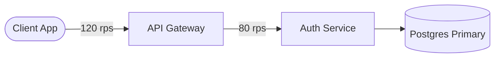

# MermaidPulse

Live interactive Mermaid editor and traffic simulator. Standard Mermaid syntax
(`flowchart`, `graph`, `sequenceDiagram`) renders as a live topology: animated
packet pulses on every edge, node heartbeat rings, latency telemetry, and
click-to-inject chaos simulation.

## Run

```bash
npm install
npm run dev        # http://localhost:5173
npm run build      # type-check + production bundle
npm run preview    # serve the production bundle
```

## Test

```bash
npm test           # Vitest unit and component suites
npm run e2e       # Playwright headless browser checks (desktop + mobile)
```

## How it works

| Layer | File | Responsibility |
| --- | --- | --- |
| Parsing | `src/lib/diagram.ts` | Flowchart/sequence syntax, node shapes, arrow kind mapping, `%% @node` and `%% @edge` directive read plus write-back |
| Telemetry | `src/lib/telemetry.ts` | Throughput, critical-path P99, success rate, blast radius, particle density and speed rules |
| Geometry | `src/lib/overlay-geometry.ts` | Maps the Mermaid-rendered SVG back onto the parsed model, path sampling and direction |
| Overlay | `src/components/OverlayLayer.tsx` | Packet particles (`animateMotion`), heartbeat rings, telemetry badges, blast-radius tint, two-way hover linking |
| Stage | `src/components/DiagramStage.tsx` | Pan, cursor-centered zoom (0.25x to 3x), fit/center/reset, chaos inspector anchoring |
| Inspector | `src/components/NodeInspector.tsx` | Health state toggle, throughput and latency sliders, writes back to source |
| Dock | `src/components/TelemetryDock.tsx` | Play/pause, single request step, load multiplier, live cluster metrics |
| Export | `src/lib/export-svg.ts`, `src/lib/share.ts` | Standalone animated SVG download, URL hash share link |

### Telemetry directives

Comments in the Mermaid source set the simulated behaviour of a node:



`status` accepts `healthy`, `degraded`, `outage`. The chaos inspector writes
these values back into the source, so the diagram and its simulation stay in
sync.

### Link semantics

| Arrow | Meaning | Traffic color |
| --- | --- | --- |
| `-->` | Synchronous HTTP or gRPC | Cyan `#38bdf8` |
| `-.->` | Async event or queue burst | Violet `#a855f7` |
| `==>` | High-throughput data pipeline | Emerald `#10b981` |

Particle count scales with RPS, particle speed scales with edge latency, and a
node in `outage` turns incoming edges crimson with dropped packets while
downstream pulses stop.
